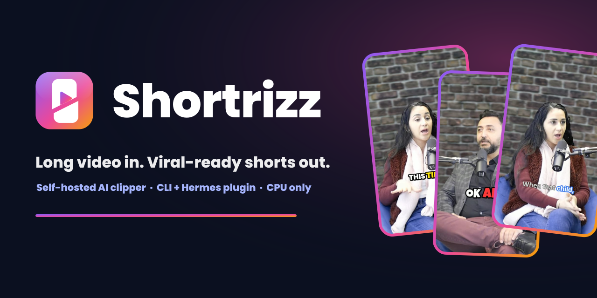
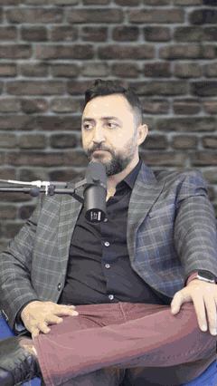
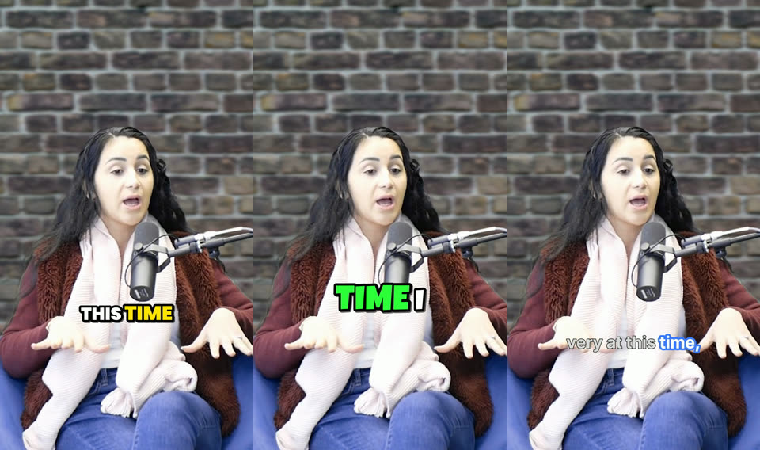
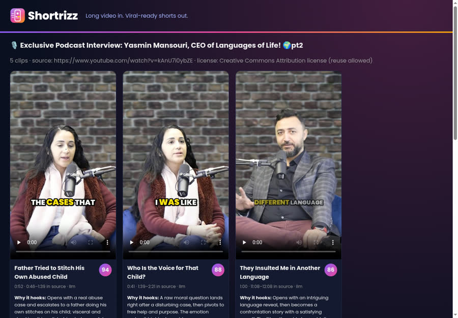
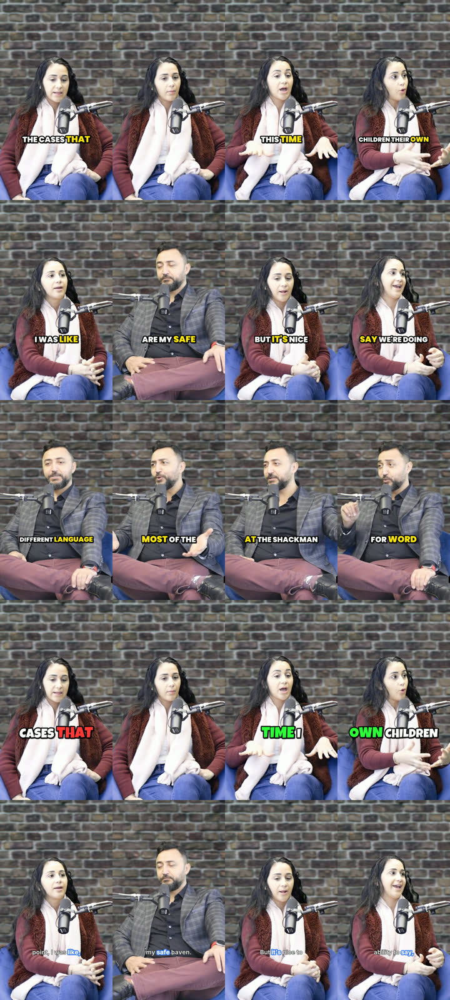
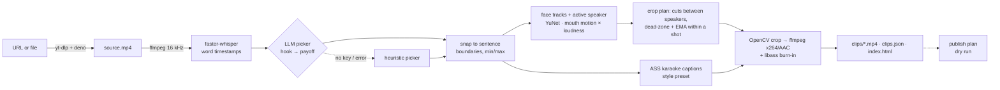

<div align="center">

<picture>
  <source media="(prefers-color-scheme: dark)" srcset="docs/media/logo-dark.svg">
  
</picture>

### Long video in. Viral-ready shorts out.

Shortrizz is a self-hosted AI clipper that runs on CPU. It transcribes a video with faster-whisper, picks the
best moments with an LLM, reframes them to 9:16 by following the speaker's face, and burns in word-by-word
captions in the Hormozi, MrBeast or Abdaal style. You can use it as a CLI or as a Hermes plugin.

[](LICENSE)
[](pyproject.toml)
[](#hermes-plugin)
[](https://github.com/SYSTRAN/faster-whisper)
[](https://ffmpeg.org)
[](#how-it-works)



<sub>A sibling of <a href="https://github.com/mojomast/comfyrizz">Comfyrizz</a>. Comfyrizz makes explainers. Shortrizz clips them.</sub>

[Quickstart](#quickstart) · [Features](#features) · [Highlights](#long-form-highlights) · [Hermes plugin](#hermes-plugin) · [Styles](#caption-styles) · [How it works](#how-it-works) · [Limitations](#limitations)

</div>

---

> **Only clip content you have the rights to.** That means your own videos, Creative Commons material with
> attribution, or videos in creators' official clipping campaigns, where creators pay clippers to cut their
> content. Re-uploading anyone else's video without permission is copyright infringement and breaks platform
> rules.

## What it does



1. **Paste a URL.** Any URL yt-dlp supports (YouTube and others) works, and so does a local file.
2. **Transcribe.** faster-whisper runs on CPU and produces word-level timestamps.
3. **Pick moments.** An LLM reads the timestamped transcript and returns 30–60 s segments. Each segment starts
   on a hook and ends on a complete thought, and its boundaries are snapped to sentence edges.
4. **Reframe 16:9 to 9:16.** Shortrizz tracks faces, picks the active speaker, cuts between speakers, and follows
   smoothly within a shot so the frame doesn't jitter.
5. **Caption.** Bold karaoke-style captions with the current word highlighted, 2–4 words per line.
6. **Ship.** You get 1080×1920 H.264/AAC MP4s and a `clips.json` with a title, a virality score from 0 to 100,
   the duration, a short note on why it hooks, and a platform caption with hashtags. There's also a branded
   `index.html` gallery and an optional dry-run posting schedule.

<br clear="right">

## Features

- **One command, a feed of clips.** For example: `shortrizz URL --count 5 --min 30 --max 60 --style hormozi`.
- **Or one 16:9 highlights reel.** `shortrizz highlights URL` joins the top-scoring moments into a single horizontal video. See [Long-form highlights](#long-form-highlights).
- **LLM clip picker.** It uses any OpenAI-compatible endpoint, with OpenCode Go `deepseek-v4.1-flash` as the
  default. If no key is set, a heuristic picker takes over, so it works offline.
- **Speaker-aware reframing.** Faces are detected with YuNet. The active speaker is found from mouth motion
  weighted by loudness. A minimum shot length and hysteresis stop the frame from flickering. When no face is
  found, it falls back to a blurred letterbox.
- **Caption styles.** Hormozi, MrBeast and Abdaal presets, plus custom styles in JSON. Long lines shrink to fit.
- **Shorts-ready output.** yuv420p, `+faststart`, and loudness normalised to -14 LUFS.
- **Caching.** Downloads, transcripts and LLM picks are cached, so re-rendering in another style is fast.
- **Posting plan.** A pluggable `publish` interface for YouTube, TikTok and Instagram. Live posting is
  deliberately not implemented, so it only writes a plan.
- **Hermes plugin.** Five tools and an agent skill. Long renders run as background jobs.
- **Optional watermark.** A small Shortrizz logo in a corner, off by default. See [Watermark](#watermark-off-by-default).

## Quickstart

Requirements: Python 3.10 or newer, `ffmpeg`/`ffprobe` on PATH, and about 1 GB of disk for the Whisper model and
cache. `deno` on PATH is optional, but YouTube downloads are more reliable with it.

```bash
git clone https://github.com/mojomast/hermes-shortrizz shortrizz && cd shortrizz
python3 -m venv .venv && .venv/bin/pip install -e .
export OPENCODE_GO_API_KEY=...        # optional. Without it, the heuristic picks clips.
.venv/bin/shortrizz "https://www.youtube.com/watch?v=VIDEO_ID" --count 5 --style hormozi --out ./out
xdg-open out/index.html
```

The YuNet face model (230 KB) and the Whisper weights download on first use to `~/.cache/shortrizz/models`.

## CLI

```
shortrizz SOURCE [--count 5] [--min 30] [--max 60] [--style hormozi|mrbeast|abdaal|my.json]
                 [--out DIR] [--model small] [--language en] [--reframe auto|face|center|letterbox]
                 [--no-llm] [--fresh] [--preset medium] [--schedule youtube,tiktok,instagram] [--json]
                 [--watermark | --no-watermark]
shortrizz highlights SOURCE [--duration 180] [--max-clips 8] [--min-score 50]
                 [--min 15] [--max 45] [--order chrono|score] [--crossfade 0.4 | --hard-cuts]
                 [--style hormozi] [--no-captions] [--out DIR] [--no-llm] [--json]
shortrizz restyle RUN_DIR --style mrbeast [--out DIR] [--watermark]  # re-render a finished run with another style
shortrizz publish RUN_DIR [--platforms youtube,tiktok]    # write publish_plan.json (dry run)
shortrizz styles                                          # list presets
```

| env var | default | meaning |
|---|---|---|
| `OPENCODE_GO_API_KEY` | read from `$HERMES_HOME/.env` if it isn't already set | LLM key |
| `SHORTRIZZ_ENV_FILE` | `$HERMES_HOME/.env` or `~/.hermes/.env` | dotenv file to load the key from |
| `SHORTRIZZ_LLM_BASE_URL` | `https://opencode.ai/zen/go/v1` | OpenAI-compatible base URL |
| `SHORTRIZZ_LLM_MODEL` | `deepseek-v4.1-flash` | model |
| `SHORTRIZZ_MODELS` | `~/.cache/shortrizz/models` | YuNet and Whisper weights |
| `SHORTRIZZ_RUNS` | `~/shortrizz-runs` | default output folder for plugin runs |

## Long-form highlights

`shortrizz highlights` builds **one** 16:9 video from several high-scoring moments of the same source. It runs the same download, faster-whisper transcript and virality scoring as the shorts command (LLM, or the heuristic when no key is set), snaps each segment to a sentence or a pause so speech is not cut mid-word, then joins the picks.

```bash
shortrizz highlights "https://www.youtube.com/watch?v=VIDEO_ID" \
    --duration 180 --max-clips 8 --min-score 50 --order chrono --style hormozi --out ./out
```

| flag | default | meaning |
|---|---|---|
| `--duration` | 180 | Target length in seconds. Segments are kept whole, so the file may run a few seconds past this. `0` turns the cap off. |
| `--max-clips` | 8 | Stop after this many segments. `0` turns the cap off. With both caps off, the reel uses 8. |
| `--min-score` | 50 | Drop anything the scorer marked below this (0–100). |
| `--min` / `--max` | 15 / 45 | Length of each segment, in seconds. |
| `--order` | `chrono` | `chrono` plays source order so the story flows. `score` plays the strongest first. |
| `--crossfade` | 0.4 | Audio and video crossfade at each join, in seconds. |
| `--hard-cuts` | off | Butt-join with no crossfade. |
| `--style` / `--no-captions` | hormozi, captions on | Same caption presets as shorts, drawn in the lower third of the 16:9 frame. |
| `--no-loudnorm` | loudness on | Each segment is normalised to −14 LUFS before the join. |
| `--max-width` | 1920 | Cap the frame width. A 16:9 source keeps its own size up to this. Wider sources are scaled down. Other aspect ratios are padded, not cropped. |
| `--no-chapters` / `--no-manifest` | both written | `chapters.txt` lists each segment's output time, score and source time. `highlights.json` is the machine-readable manifest. |

The output folder holds `highlights.mp4`, `highlights.jpg`, `chapters.txt`, `highlights.json`, `clips.json` and `index.html`. Segments that overlap, or that repeat the same words, are dropped. The reel does **not** run the vertical reframe or the shorts edit pass (dead-air tightening, hook text, cold open, zoom, emoji). `shortrizz restyle` and `shortrizz publish` stay on the shorts feed.

The Hermes tool is `shortrizz_make_highlights`. It takes the same knobs (`duration`, `max_clips`, `min_score`, `order`, `crossfade`, `hard_cuts`, `captions`, `style`, …) and returns a `job_id` to poll with `shortrizz_status`.

## Hermes plugin

The repo root is a Hermes plugin. It contains `plugin.yaml`, the `__init__.py` entry point, and the skill in
`skills/shortrizz-clipper/SKILL.md`.

```bash
hermes plugins install mojomast/hermes-shortrizz --enable
hermes plugins doctor shortrizz
```

| Tool | Job |
|---|---|
| `shortrizz_make_shorts` | Starts a job for `source` with `count`, `min_seconds`, `max_seconds`, `style`, `reframe`, `model`, `use_llm`, `watermark`, `out_dir` and `wait_seconds`. Returns a `job_id` and `out_dir`. |
| `shortrizz_make_highlights` | Starts a job that builds one 16:9 highlights video from the top-scoring moments. Knobs: `duration`, `max_clips`, `min_score`, `min_seconds`, `max_seconds`, `order`, `crossfade`, `hard_cuts`, `captions`, `style`, `loudnorm`, `model`, `use_llm`, `watermark`, `out_dir`, `wait_seconds`. |
| `shortrizz_status` | Reports a job's progress (download, transcribe, select, render n/total). When the job is done, it returns the clip paths, titles, scores, durations, why-it-hooks notes and captions. `cancel: true` stops the job. |
| `shortrizz_list_styles` | Lists the caption presets and reframe modes. |
| `shortrizz_render_style` | Re-renders a finished `run_dir` in another `style`, without downloading, transcribing or calling the LLM again. Runs as a background job. |
| `shortrizz_publish_plan` | Writes `publish_plan.json` as a dry run for YouTube Shorts, TikTok and Instagram Reels. It never uploads anything. |

**Long jobs.** Rendering takes minutes, so each job runs as a detached `python -m shortrizz` process and reports
progress in `out_dir/progress.json`. A tool call returns right away, or after `wait_seconds` (at most 280 s,
which keeps it under Hermes' tool timeout). The agent polls `shortrizz_status` until the job is done. On a failed
job, `log_tail` holds the last lines of the job log. Loading the plugin doesn't import OpenCV or Whisper.

## Deeper edits

Every clip goes through an edit pass before it is rendered. These are **on by default**:

- **Dead-air tightening.** Pauses longer than 0.35 s shrink to about 0.15 s instead of being cut to zero. Cuts keep 0.08 s before a word and up to 0.12 s after it, using the silero-vad model bundled with faster-whisper so trailing consonants are not clipped. Every join gets a 15 ms equal-power audio crossfade. Captions are retimed onto the new timeline. Presets are `--edit off|light|normal|aggressive`.
- **LLM edit pass.** A second, cheap LLM call returns a word-index EDL: false starts, repeats and fillers to drop, a hook line, emphasis words and more. Code validates the EDL before it is used:
  - cuts land only on word boundaries;
  - numbers and negations (not, never, no, n't…) are never dropped;
  - only true fillers ("um", "you know", "I mean", "like," used as a filler), exact stutter repeats ("that's that's") and restarts ("we went, we drove") can go. Pronouns, connectives and other meaning-bearing words ("I", "which is", "because") are never cut on their own;
  - at most 12% of a clip's words can be removed;
  - each dropped span is at most 6 words.

  Simple rules catch um/uh and immediate 1–3-word repeats even without the LLM. (Priming Whisper with a filler-style prompt was tested and rejected: it made Whisper skip most of the speech.) The EDL is saved as `NAME.edl.json` and in the cache, so `restyle` re-renders without the LLM. Disable the LLM pass with `--no-llm-edits`.
- **Hook text.** A 2–6-word on-screen hook shows for the first 0–2.8 s, below the top 288 px. Disable it with `--no-hook-text`.
- **Face-aware text.** Captions keep their style position unless it would cover a face; then they move below the chin or above the eyes, staying inside the safe zones. The zone is chosen once per shot (with hysteresis), so captions don't jump around on close-ups. The hook text also moves off the speaker's head (hair, face and sides). Captions are hidden while the end card shows. Emoji pops pick a spot clear of faces, captions and the hook, trying smaller sizes and corners before skipping.
- **Loudness and safe zones.** Audio gets a two-pass `loudnorm` to −14 LUFS / −1.5 dBTP and an 80 Hz high-pass (`--no-loudnorm` turns this off). All text stays inside the union of TikTok, Reels and Shorts safe zones:
  - top 288 px;
  - captions no lower than y≈1240;
  - left 120 px and right 192 px.

  The watermark sits inside these zones as well.

These are **opt-in** and default off. Each has a CLI flag, a plugin tool parameter, and a config key in `~/.config/shortrizz/config.json` (for example `"zoom": true`). `--all-fx` turns them all on.

| flag | effect |
|---|---|
| `--cold-open` | flashes the clip's most striking 2–5 s line first (a clause is fine; long LLM picks are trimmed, and a heuristic picks one if the LLM doesn't), then a whoosh, then the clip |
| `--tts-intro` / `--tts-outro` | narrator context line / CTA over a held frame (the sharpest, steadiest frame with a clear face nearby) in a stock Kokoro-82M voice (Apache-2.0 weights via kokoro-onnx, MIT; CPU). Weights download to `~/.cache/shortrizz/kokoro`. It never clones the speaker, and clips are marked `synthetic_voice` in clips.json, so disclose AI voice where platforms require it |
| `--zoom` | 1.0→1.12 punch-in on emphasis words; alternating 1.0/1.08 scale on jump cuts |
| `--loop` | ends on the LLM's loop word with no tail or fade, so the replay flows back into the opening (when looping, the CTA is text-only) |
| `--emoji` | emoji pops above the captions (system Noto Color Emoji font) |
| `--sfx` | sparse pop/whoosh sounds at −20 dB, no closer than 3.5 s apart. They are synthesised by `scripts/make_sfx.py` and released CC0 (see `assets/sfx/LICENSE.txt`) |
| `--length tight` | 20–35 s clips. With narrator effects on, the intro/outro are skipped and the cold open shortened so the speaker fills ≥ 70% of the clip, unless `--tts-intro`/`--tts-outro` are given explicitly |

**Length budget.** The narrator intro/outro and the cold open are paid for by trimming the end of the body at a sentence end or pause, so a finished clip is never longer than its source range or the `--max` of its length band. If the body would get too short, the outro, then the intro, then the cold open are dropped first.

Sources above 30 fps are rendered at 30 fps by the edit renderer. Clips are written to `NAME.partial.mp4` and renamed when the encode finishes.

**Repeat runs.** `--avoid-previous` skips moments that earlier runs on the same video already used (recorded in the cache), and `--exclude RUN_DIR` skips one run's moments, so a second pass (for example `--length tight`) finds new material.

`--no-edits` gives the old plain render (one continuous range). clips.json reports the edits for each clip: seconds removed, cuts, dropped words, the hook, and the final length. Music beds, B-roll and split-screen are deliberately not built.

## Watermark (off by default)

Shortrizz can burn in a small white watermark: the Shortrizz mark and wordmark, with an optional "made with"
line. It sits in the top-right corner, below the platform's top bar. That keeps it clear of the captions in
the lower middle and of the face, which the reframer keeps centred. It is **off unless you turn it on**.

The first of these that is set wins:

1. `--watermark` or `--no-watermark` on the command line, or the `watermark` parameter of the Hermes tools
2. the `SHORTRIZZ_WATERMARK` environment variable, set to `1` or `0`
3. a user config file at `~/.config/shortrizz/config.json`, or wherever `$SHORTRIZZ_CONFIG` points. This file
   is never part of the repo:
   ```json
   {"watermark": true, "watermark_position": "top-right", "watermark_opacity": 0.72,
    "watermark_width": 0.26, "watermark_text": false}
   ```

`watermark_position` can be `top-right`, `top-left`, `bottom-right` or `bottom-left`. `watermark_width` is a
fraction of the frame width. `watermark_text` adds the "made with" line. Each of these can also be set as an
environment variable, `SHORTRIZZ_WATERMARK_<KEY>`.

## Caption styles



| style | look |
|---|---|
| `hormozi` | Uppercase Poppins Black. White text with the active word yellow and enlarged, a thick black outline, 3 words per line, placed in the lower middle. |
| `mrbeast` | Luckiest Guy, 2 words per line. The highlight cycles through green, yellow and red, with a heavy outline. |
| `abdaal` | Inter in sentence case. Inactive words are dimmed and the active word gets a blue glow, up to 4 words per line. |
| custom | A JSON file that sets `base` plus any keys to override (see `styles/custom-example.json`). |

Custom keys are `font`, `size`, `bold`, `upper`, `primary`, `highlight`, `highlight_cycle`, `outline`,
`outline_w`, `shadow`, `pos_y`, `max_words`, `pop`, `highlight_bg`, `highlight_bg_color`, `dim` and `char_w`.
Install the fonts you want to use. libass falls back to another font if one is missing.

## Output



Each run folder contains:

- `NN-title.mp4` and `NN-title.jpg` for each clip
- `clips.json`
- `index.html`
- `progress.json`
- `publish_plan.json`, if you asked for a posting plan

<details><summary>Contact sheet: frames from the test clips</summary>

</details>

## How it works



`shortrizz highlights` branches off after the same transcript and score. It skips the face-tracked crop and the per-clip shorts renderer, fits every chosen segment into one 16:9 frame, and crossfades them into `highlights.mp4`.

On 8 CPU cores, an 18.5-minute 1080p podcast took about 28 s to download and 1 min 46 s to transcribe with
Whisper `small` in int8 (float32, now the default, is roughly 1.5–3× slower). The LLM pick took about 45–80 s, and rendering took about 25 s per 45 s clip. A full first
run took about 5.5 minutes. A restyle takes about 2 minutes.

## Transcription safeguards

Whisper runs in **float32** on CPU by default: int8 decoding silently dropped minutes of clear speech on some sources (set `SHORTRIZZ_COMPUTE_TYPE=int8` to trade reliability for speed). Every transcript is checked before use:

- no conditioning on previous text, temperature fallback and compression/no-speech thresholds stop "I'm I'm I'm" loops; looping segments are re-transcribed on their own;
- a transcript is rejected if it loops, is too sparse for its length, or covers less than 80% of the speech that silero-vad hears. Rejected caches are redone, and a still-bad transcript stops the run with a clear message instead of making garbage clips;
- clip boundaries snap to sentence ends, then to Whisper segment edges or pauses ≥ 0.35 s, because Whisper often emits little punctuation.

## Limitations

- The active speaker is detected from video alone, with no audio diarization. Off-camera voices, people in
  profile, or heavy gesturing can fool it. Use `--reframe center` or `letterbox` to override it.
- Cropping 1080p to 9:16 upscales 608×1080 to 1080×1920, so the image gets a bit soft. A 4K source helps.
- There's no split-screen layout for two people.
- Virality scores are an LLM's judgement. They aren't trained on engagement data.
- Caption accuracy is limited by Whisper. `--model medium` or `--model large-v3` is better but slower.
- Clips can run about 0.3 s past `--max` because of the padding at the end.
- On tight close-ups there may be no face-free caption spot inside the safe zones; captions then sit on the forehead/hair rather than the mouth.
- The edit renderer processes frames in Python; expect roughly 1 minute per 40 s clip on 8 cores at 30 fps.
- Live posting isn't implemented. `shortrizz/publish.py` documents the YouTube Data API, the TikTok Content
  Posting API and the Instagram Graph API hooks.
- Highlights keeps the source framing and joins whole scored segments. It does not reframe to 9:16, tighten
  dead air inside a segment, or apply the shorts effects (hook text, cold open, zoom, emoji, narrator).
- A highlights file can run a few seconds past `--duration`, because a segment is never chopped to hit the
  number. Each crossfade shortens the total by about its length.
- `shortrizz restyle` and `shortrizz publish` are for a shorts folder. A highlights run is one 16:9 file.

## Brand


The mark is a 9:16 phone with a play button, cut by one diagonal slice: a clip cut out of a long video. It is
a sibling of the Comfyrizz tile, with the same rounded gradient square and gloss, recoloured violet to pink to
amber. Every asset is a hand-authored vector with the text converted to outlines:

- `logo-light.svg` and `logo-dark.svg`
- `logo-mono-white.svg` and `logo-mono-dark.svg`
- `icon.svg`
- `banner.png`

`scripts/make_brand.py` regenerates all of them, along with the watermark PNGs.

<br clear="left">

## Development

```bash
.venv/bin/pip install -e '.[dev]' && .venv/bin/python -m pytest -q tests
.venv/bin/pip install cairosvg fonttools && .venv/bin/python scripts/make_brand.py --thumbs a.jpg b.jpg c.jpg
```

## Credits and licenses

- Shortrizz code: MIT, © 2026 Kyle Durepos ([mojomast](https://github.com/mojomast)). This is a community
  project. It is not affiliated with Opus Clip, Ssemble or Nous Research.
- The preview images and GIF in `docs/media` are frames from "🎙️ Exclusive Podcast Interview: Yasmin Mansouri,
  CEO of Languages of Life!" by **Kanata On The Rocks – Yasmin Mansouri**, licensed
  [CC BY](https://creativecommons.org/licenses/by/3.0/) on YouTube (`kAnU7i0ybZE`). The frames are cropped and
  captioned.
- Built on [faster-whisper](https://github.com/SYSTRAN/faster-whisper) (MIT),
  [yt-dlp](https://github.com/yt-dlp/yt-dlp) (Unlicense), [OpenCV](https://opencv.org) with the
  [YuNet](https://github.com/opencv/opencv_zoo) face model (Apache-2.0 / MIT), and
  [FFmpeg](https://ffmpeg.org) with libass (LGPL/GPL).
- Fonts: Poppins, Luckiest Guy, Inter and Anton (SIL OFL), from Google Fonts. They aren't bundled.
