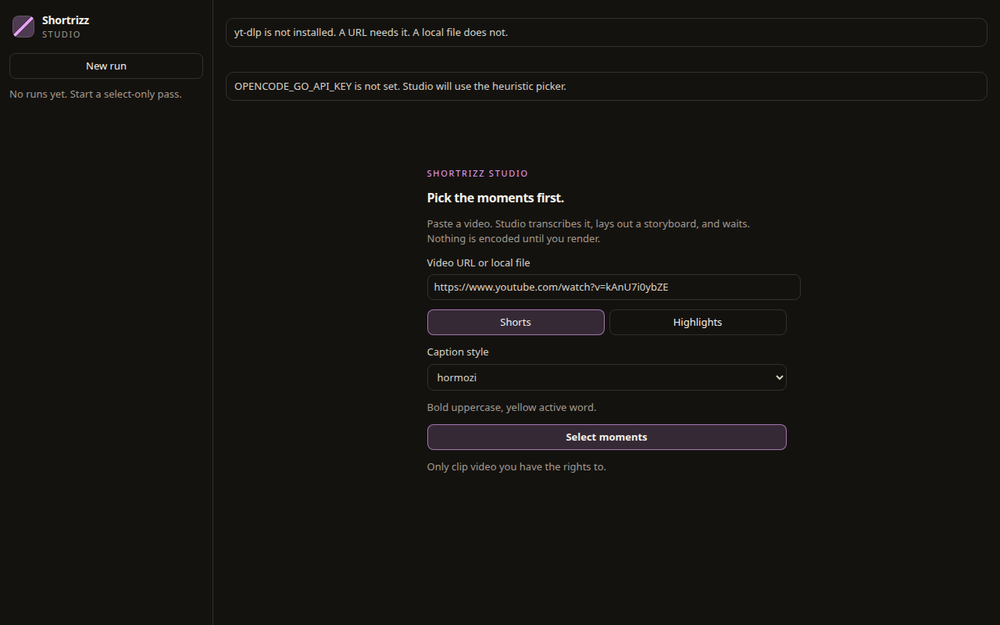
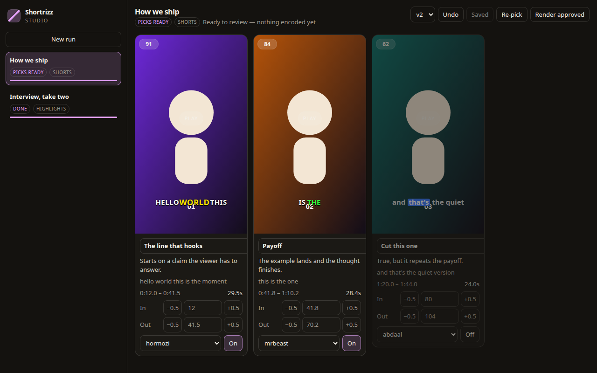
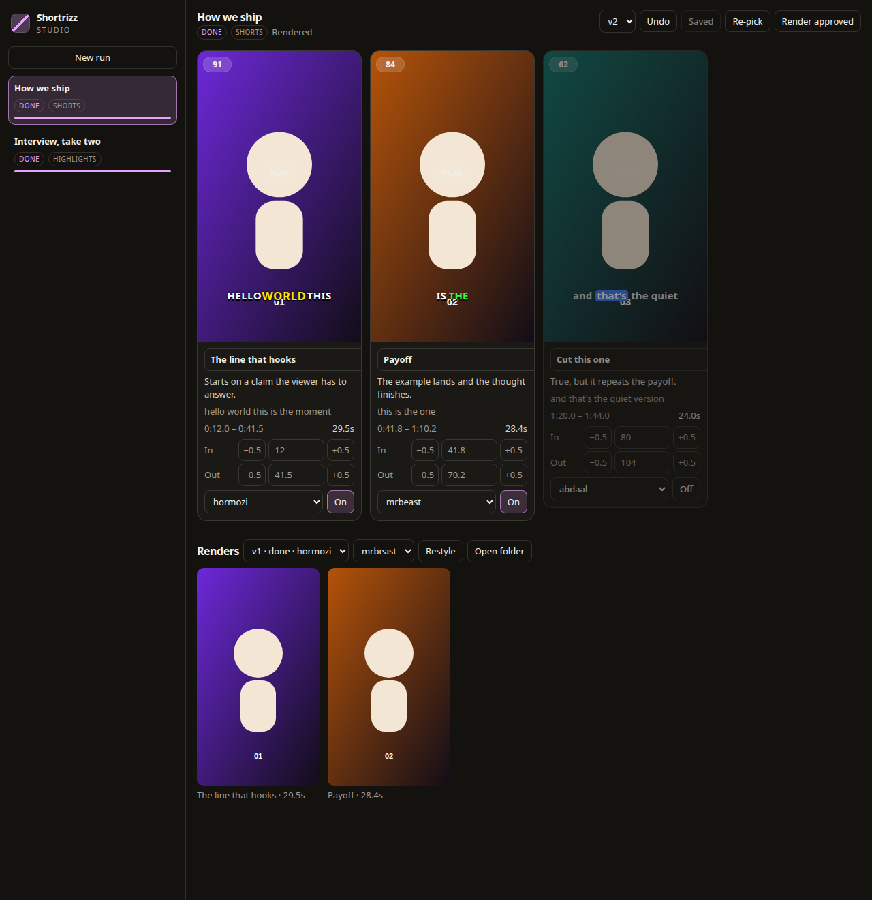
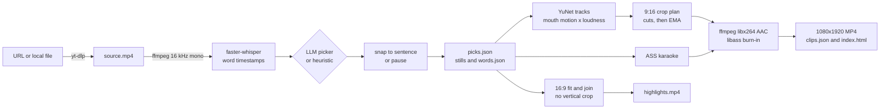

<div align="center">

<picture>
  <source media="(prefers-color-scheme: dark)" srcset="docs/media/logo-dark.svg">
  
</picture>

# Shortrizz

**Long video in. 9:16 shorts with face-tracked reframing and karaoke captions, plus one 16:9 highlights reel.**

A self-hosted clipper for the [Nous Research Hermes](https://github.com/NousResearch/hermes-agent) hackathon.
Paste a URL or a local file. Shortrizz transcribes it on CPU, picks moments, and renders.
It is a CLI and a Hermes plugin (`shortrizz`), with a Desktop pane for review before any encode.

[](LICENSE)
[](plugin.yaml)
[](plugin.yaml)
[](pyproject.toml)
[](#development)


<!--
Demo placeholder. A walkthrough video of Shortrizz Studio (select, storyboard, render,
inline playback) goes here only after a file exists in this repo. Do not add an
 or <video> tag until that path is real. Stills that do exist:
docs/images/studio-onboarding.png, docs/images/studio-storyboard.png,
docs/images/studio-render.png. Caption motion that does exist: docs/media/preview.gif.
-->

<sub>A sibling of <a href="https://github.com/mojomast/comfyrizz">Comfyrizz</a>. Comfyrizz makes explainers. Shortrizz clips them. Not affiliated with Opus Clip, Ssemble, or Nous Research.</sub>

[Quickstart](#quickstart) · [Studio](#shortrizz-studio) · [Review then render](#review-then-render) · [Tools](#tools) · [Pipeline](#pipeline) · [Styles](#caption-styles) · [Security](#security-and-privacy) · [FAQ](#troubleshooting) · [Development](#development)

</div>

---

> **Only clip content you have the rights to.** That means your own videos, Creative Commons material with
> attribution, or videos in a creator's official clipping campaign. Re-uploading someone else's video without
> permission is copyright infringement. The plugin description, the Desktop pane, and the bundled skill all say the same thing.

## What it does


1. **Ingest.** A URL yt-dlp can read, or a local file.
2. **Transcribe.** faster-whisper on CPU, with word timestamps.
3. **Pick.** An LLM (or a heuristic when no key is set) chooses moments. Shorts default to 30–60 s. Highlights default to 15–45 s segments inside one 16:9 reel.
4. **Reframe shorts to 9:16.** YuNet face tracks, an active-speaker score from mouth motion weighted by loudness, cuts between speakers, and a smooth follow inside a shot. No faces at all falls back to a blurred letterbox. Highlights keep the source framing.
5. **Caption.** ASS karaoke, 2–4 words per page, current word highlighted. Presets: Hormozi, MrBeast, Abdaal, or a JSON file.
6. **Write.** 1080×1920 H.264/AAC MP4s (`yuv420p`, `+faststart`), `clips.json` (title, virality score 0–100, duration, why it hooks, caption, hashtags), and an `index.html` gallery. Publishing is a dry-run plan. Nothing is uploaded.

<br clear="right">

The default shorts pass also tightens dead air, drops validated fillers and restarts, draws a short hook line, loudness-normalises to −14 LUFS, and keeps text inside platform safe zones. Those edits are on unless you turn them off. A second set of effects (cold open, narrator, zoom, loop, emoji, sound effects) stays off until you ask.

## Quickstart

Plugin id is **`shortrizz`** (`plugin.yaml` `name`). Hermes requirement is **`>=0.23.0`**.

```bash
hermes plugins install mojomast/hermes-shortrizz --enable
hermes plugins doctor shortrizz
```

`plugin.yaml` declares `OPENCODE_GO_API_KEY` in `requires_env` with `secret: true`, and says Hermes loads this plugin only when that key is set. The CLI still runs without it and uses the heuristic picker.

### Requirements

| Need | Why |
|---|---|
| Python 3.10+ | `requires-python` in `pyproject.toml`. |
| `ffmpeg` and `ffprobe` on `PATH` | Audio extract, stills, proxies, and the encode. Caption burn-in uses ffmpeg's `ass` filter, so the build needs **libass**. |
| `yt-dlp` | A URL. A local file does not need it. Installed with the package (`yt-dlp>=2025.1.1,<2028`). `deno` on `PATH` is optional; when it is present, YouTube downloads pass `--js-runtimes` and retry without it if that fails. |
| `faster-whisper`, `opencv-python-headless`, `numpy`, `requests` | The pinned ranges in `plugin.yaml` / `pyproject.toml`. Whisper weights download on first transcription into `SHORTRIZZ_MODELS` (default `~/.cache/shortrizz/models`). |
| YuNet ONNX | Face detection. Downloaded once into the same models directory, from a pinned opencv_zoo commit, and rejected unless the SHA-256 matches. If the download fails, detection falls back to OpenCV's Haar cascade. |
| `kokoro-onnx` and `soundfile` | Optional. `pip install -e '.[tts]'` (`kokoro-onnx>=0.4,<1`). Only the opt-in narrator uses them. |

CPU only. The plugin entry point does not import OpenCV or faster-whisper; the background job does.

Local CLI, without Hermes:

```bash
git clone https://github.com/mojomast/hermes-shortrizz shortrizz && cd shortrizz
python3 -m venv .venv && .venv/bin/pip install -e .
.venv/bin/shortrizz "https://www.youtube.com/watch?v=VIDEO_ID" --count 5 --style hormozi --out ./out
```

That one-shot command selects and encodes. It also writes `picks.json`. Output default for the CLI is `./shortrizz-out`.

### Environment variables

Names only. Shortrizz does not open a dotenv file. Set secrets in the Hermes secret scope (or in the process environment for the CLI). Do not commit them.

| Name | Role |
|---|---|
| `OPENCODE_GO_API_KEY` | The only declared secret (`requires_env`, `secret: true`). Read with `agent.secret_scope.get_secret` when that module imports. Otherwise the same name is read from the environment. A name that is not declared is refused. Unset: the heuristic picker runs. |
| `SHORTRIZZ_LLM_BASE_URL` | OpenAI-compatible base URL for the picker and the edit pass. Default lives in `shortrizz/clipselect.py`. |
| `SHORTRIZZ_LLM_MODEL` | Chat model. Default `deepseek-v4.1-flash`. |
| `SHORTRIZZ_RUNS` | Plugin `out_dir` and `picks_path` must resolve inside this directory. Default `~/shortrizz-runs`. |
| `SHORTRIZZ_CACHE` | Plugin `cache_dir` must resolve inside this directory. Default `~/.cache/shortrizz`. |
| `SHORTRIZZ_HOME` | Job records (`jobs/<job_id>.json`). Default `~/.cache/shortrizz`. |
| `SHORTRIZZ_MODELS` | YuNet and Whisper weights. Default `~/.cache/shortrizz/models`. |
| `SHORTRIZZ_COMPUTE_TYPE` | faster-whisper compute type. Default `float32`. |
| `SHORTRIZZ_OFFLINE` | `1` skips fetching a missing pinned model file. |
| `SHORTRIZZ_CONFIG` | User config file. Default `~/.config/shortrizz/config.json`. Never part of the repo. |
| `SHORTRIZZ_WATERMARK` | `1` or `0`. See [Watermark](#watermark). |
| `SHORTRIZZ_WATERMARK_<KEY>` | Position, opacity, width, text. |
| `SHORTRIZZ_KOKORO_DIR` | Kokoro weights. Default `~/.cache/shortrizz/kokoro`. |
| `SHORTRIZZ_TTS_VOICE` | Stock Kokoro voice. Default `am_michael`. It does not clone the speaker. |
| `SHORTRIZZ_DEBUG` | When set, the reframe planner logs the speaker timeline. |
| `SHORTRIZZ_<EDIT_KEY>` | Overrides an edit default (`EDIT`, `LLM_EDITS`, `HOOK_TEXT`, `LOUDNORM`, `COLD_OPEN`, `TTS_INTRO`, `TTS_OUTRO`, `ZOOM`, `LOOP`, `EMOJI`, `SFX`) after the config file and before a CLI flag. |

Background jobs copy an allowlist, not the parent environment. See [Security and privacy](#security-and-privacy).

## Shortrizz Studio

Studio is the Hermes Desktop pane (`desktop/plugin.js`, label **Shortrizz Studio**). It needs Hermes `>=0.23.0`. The pane is a right-hand surface, 960px wide (`desktop/src/ui/register.js`). It talks only to `/api/plugins/shortrizz/` (`dashboard/plugin_api.py`). It does not register tools. The six `shortrizz_*` tools stay as they are.

After you deploy or update the plugin, Desktop can keep a stale pane. Open **Capabilities → Plugins → Rescan**. If the backend is not connected, the pane says to enable the Shortrizz plugin, then rescan.



Paste a URL or a local file, choose shorts or highlights, and start. That call is select-only (`stage: select`). Nothing is encoded yet. If `ffmpeg`, `ffprobe`, or `yt-dlp` is missing, Studio names the dependency and what to do. It reports whether `OPENCODE_GO_API_KEY` is set, and never returns the value. Without the key, selection uses the heuristic picker.



Each pick is a card: still, score, title, hook, transcript snippet, duration, and in/out times. Hovering the frame builds a cached 360p proxy (`previews/<id>_<startMs>_<endMs>.mp4`, scale width 360, no burned captions) and plays it. A click pins playback so it keeps going after the pointer leaves. A CSS overlay approximates the Hormozi, MrBeast, or Abdaal caption on the still and on the proxy. The encode still burns real ASS.

Edit the title (trimmed at 140 characters), nudge in or out by 0.5 s, type a time, pick a caption style, turn a card off, or drag to reorder. Nudges and saves snap to `words.json` when that sidecar exists (nearest word edge within 0.45 s on save, 0.55 s on a nudge). Missing words keep the number you typed.

**Save** writes `picks.json` and, when the document changed, the next `picks.vN.json`. The version menu and **Undo** restore an older revision by saving it as the new head. History files are not deleted. **Re-pick** starts selection again with `avoid_previous`. **Render approved** (or **Save & render** when the storyboard is dirty) encodes enabled picks into `renders/vN/` and reports progress per clip. Earlier renders stay.



Finished MP4s play inline in the render strip. **Restyle** encodes another built-in caption style into the next `renders/vN/`. Restyle is for a shorts render; a highlights file is refused. **Open folder** reveals the run directory (`ctx.os.revealPath`).

Every still, proxy, and MP4 is read through the runs root. Paths that leave that root, including symlink escapes, are rejected. Responses drop source paths, logs, and any string that contains the API key.

## Review, then render

Select and encode are separate. The default one-shot command still does both, and writes `picks.json` before the encode.

| Step | CLI | Tool |
|---|---|---|
| Select only | `shortrizz SOURCE --select-only` or `shortrizz highlights SOURCE --select-only` | `shortrizz_make_shorts` or `shortrizz_make_highlights` with `stage: "select"` |
| What you get | `<run>/picks.json`, `picks.vN.json`, `stills/<id>.jpg` (360 px wide, midpoint of the pick), and `words.json` | Poll `shortrizz_status` until `stage` is `picks_ready` and `status` is `done` |
| Edit | Trim `start` / `end`, `title`, `caption_style`, `enabled`, `order` | Same file. Schema is [docs/PICKS_CONTRACT.md](docs/PICKS_CONTRACT.md) (version 1). |
| Render | `shortrizz --picks <run>/picks.json` or `shortrizz highlights --picks <run>/picks.json` | Same make tool with `stage: "render"` and `picks_path` |

`--select-only` and `--picks` cannot be combined. Omitting `--out` renders into the picks directory. `render_from_picks` encodes **enabled** picks, lowest `order` first, and honours each pick's `start`, `end`, `title`, and `caption_style`. A shorts file must be rendered with `shortrizz --picks`. A highlights file must be rendered with `shortrizz highlights --picks`.

Plugin `out_dir` and `picks_path` must resolve inside `SHORTRIZZ_RUNS`. Plugin `cache_dir` must resolve inside `SHORTRIZZ_CACHE`. The CLI `--out` path is not confined, so `shortrizz URL --out ./out` still works.

`shortrizz_status` on a picks-ready job returns one summary per pick: `id`, `order`, `enabled`, `start`, `end`, `score`, `title`, `hook`, `caption_style`, and an absolute `still`.

## Tools

Six tools, registered from `shortrizz/hermes_tools.py` under toolset `shortrizz`. Every response is JSON and includes `skill_id` `shortrizz:shortrizz-clipper`. Long work starts `python -m shortrizz` in a new session and returns immediately, or after `wait_seconds` (0–280). Poll with `shortrizz_status`.

| Tool | Key parameters | Returns |
|---|---|---|
| `shortrizz_make_shorts` | `source` (required in the schema). `count` 1–20 (default 5), `min_seconds` / `max_seconds` (default 30 / 60, each 5–180), `style`, `reframe` `auto\|face\|center\|letterbox`, `model` `tiny\|base\|small\|medium\|large-v3\|distil-large-v3` (default `small`), `use_llm`, `length` `default\|tight`, `avoid_previous`, `watermark`, `out_dir`, `cache_dir`, `stage` `all\|select\|render`, `picks_path` (required by the handler when `stage` is `render`), edit flags below, `wait_seconds`. | Job object: `job_id`, `kind`, `out_dir`, `status` (`running`, `done`, or `failed`), `stage`, `progress` `{done, total}`, `elapsed_sec`, `note`. Done shorts include `result` (clip paths, titles, scores, durations, why-it-hooks, captions, gallery). `stage: select` stops at `picks_ready`. |
| `shortrizz_make_highlights` | `source` (required). `duration` (default 180; `0` uncapped), `max_clips` (default 8; `0` uncapped; both off uses 8), `min_score` (default 50), `min_seconds` / `max_seconds` (default 15 / 45), `order` `chrono\|score`, `crossfade` (default 0.4), `hard_cuts`, `captions`, `loudnorm`, `chapters`, `manifest`, `style`, `model`, `use_llm`, `avoid_previous`, `watermark`, `out_dir`, `cache_dir`, `stage`, `picks_path`, `wait_seconds`. | Same job object. `kind` is `highlights`. A finished job's `result` includes the 16:9 file, duration, size, order, `chapters.txt`, and `highlights.json`. |
| `shortrizz_status` | `job_id` (required), `wait_seconds`, `cancel`. | The job object above. `cancel: true` sends `SIGTERM` to the job's process group and returns `status: cancelled`. A failed job includes `log_tail` (last 12 log lines) and `error`. |
| `shortrizz_list_styles` | None. | `ok`, `builtin` (hormozi, mrbeast, abdaal: description, font, `max_words`), `custom` (how to point at a JSON file), `reframe_modes`. |
| `shortrizz_render_style` | `run_dir` and `style` (both required). Optional `reframe`, `watermark`, the edit flags, `out_dir`, `wait_seconds`. `run_dir` must contain `clips.json`. | A restyle job (`kind: restyle`). No download, no transcription, no new LLM pick. Saved edit decisions are reused. |
| `shortrizz_publish_plan` | `run_dir` (required), `platforms` (`youtube`, `tiktok`, `instagram`; default all three), `every_hours` (default 24, range 0.25–336). | Synchronous. `ok`, `dry_run: true`, `plan_file` (`publish_plan.json`), and `posts`. Refuses a highlights `clips.json`. Never uploads. |

Edit flags on `shortrizz_make_shorts` and `shortrizz_render_style` (highlights does not take them):

| Parameter | Default | Effect when changed |
|---|---|---|
| `edit` | `normal` | `off`, `light`, `normal`, or `aggressive` dead-air preset. |
| `deeper_edits` | true | `false` is a plain continuous render (`--no-edits`). |
| `llm_edits` | true | `false` skips the second LLM edit pass. |
| `hook_text` | true | `false` skips the on-screen hook. |
| `loudnorm` | true | `false` skips loudness normalisation. |
| `cold_open`, `tts_intro`, `tts_outro`, `zoom`, `loop`, `emoji`, `sfx` | false | `true` opts in. |
| `length` | `default` | `tight` forces a 20–35 s band (make shorts only). |
| `avoid_previous` | false | Skip moments earlier runs on this video already used. |

`shortrizz_make_highlights` uses its own `loudnorm` (default on) for the per-segment normalise. It does not run the shorts edit pass.

### Bundled skill

`skills/shortrizz-clipper/SKILL.md` is registered as skill name `shortrizz-clipper`. The id inside the file is **`shortrizz:shortrizz-clipper`** (version 0.5.0). The agent loads it with `skill_view("shortrizz:shortrizz-clipper")`. The skill tells the agent to call the tools, poll `shortrizz_status`, refuse uploads, and send the user to Studio when they want to review picks first. It says not to shell out to the CLI when the tools are available.

## Pipeline



**Download.** yt-dlp, cached by video id under the cache directory. Format selection prefers a video up to 1080p. Local files are used in place.

**Transcribe.** faster-whisper, `device="cpu"`, default model `small`, default compute type `float32` (`SHORTRIZZ_COMPUTE_TYPE` overrides). Word timestamps, VAD filter, no conditioning on previous text, a temperature fallback, and compression / no-speech thresholds. Looping segments are re-transcribed alone. A transcript is rejected when it loops, is too sparse for its length (under 40 words per minute on a source longer than 120 s), or covers less than 80% of the speech silero-vad hears. A rejected cache is redone. A still-bad transcript stops the run. The cache file is `<stem>.<model>.words.json`.

**Pick.** `SHORTRIZZ_LLM_MODEL` at `SHORTRIZZ_LLM_BASE_URL` when `OPENCODE_GO_API_KEY` resolves. On a missing key or an error, the heuristic scores hooks and questions. Boundaries snap to a sentence end, otherwise to a Whisper segment edge or a pause of at least 0.35 s. A shorts range then starts 0.08 s before the first kept word and ends 0.25 s after the last, so the file can run past `--max` by that tail. A highlights segment uses a shorter pad (0.12 s before, 0.18 s after) and never crosses into the next word. Hashtags are de-duplicated case-insensitively and capped at 8. Picks are cached, so a restyle does not call the picker again. `--fresh` ignores the cached picks.

**Reframe (shorts).** Analysis at 960 px wide and 6 fps. YuNet (Haar if the model is missing). Active speaker is mouth-region motion, with head motion subtracted, multiplied by loudness. A new speaker needs a minimum shot of 3 s and a score at least 1.6× the current shot. Inside a shot the crop uses an 8% dead zone and an exponential moving average. Output is 1080×1920. A 1080p 16:9 source is cropped to 608×1080 and scaled up, so a 4K source stays sharper. `--reframe center` or `letterbox` skips face tracking. There is no two-person split screen.

**Captions and edits.** ASS events, one per word, whole page visible, active word recoloured. The edit renderer (on by default) then:

- Shrinks pauses longer than 0.35 s to 0.15 s (`--edit normal`). Light uses 0.60 → 0.25 s. Aggressive uses 0.25 → 0.08 s. Cuts keep 0.08 s before a word and 0.12 s after it (0.06 / 0.10 on aggressive), aligned with the silero-vad model bundled with faster-whisper. Joins use an equal-power `acrossfade` of 15 ms (12 ms on aggressive).
- Asks the LLM for a word-index edit list, then validates it: cuts only on word boundaries; numbers and negations stay; only fillers, exact repeats, and restarts may go; at most 12% of the clip's words; each dropped span is at most 6 words. Rules still catch `um` / `uh` and immediate 1–3 word repeats with no LLM. The list is saved as `NAME.edl.json` and in the cache. The edit call uses a 60 s request timeout inside a 120 s deadline. The picker request timeout is 300 s.
- Draws hook text for up to 2.8 s, 2–6 words, below the top 288 px safe line, moved off the speaker's head.
- Moves captions off a face for the whole shot (with hysteresis). Captions hide while an end card is on screen.
- Runs a two-pass `loudnorm` at `I=-14:TP=-1.5:LRA=11` and an 80 Hz high-pass. `--no-loudnorm` skips the loudnorm. Safe zones on a 1080×1920 frame: top 288 px, captions no lower than y≈1240, left 120 px, right 192 px.

Opt-in, default off (`--all-fx` turns them all on; each is also a config key and a tool parameter):

| Flag | What the code does |
|---|---|
| `--cold-open` | Plays a 2–5 s line from later in the clip first, then a whoosh, then the body. A long pick is shortened only to a phrase end. |
| `--tts-intro` / `--tts-outro` | Kokoro-82M stock voice over a held frame (the sharpest, steadiest frame with a clear face nearby). Weights are SHA-256 checked. Clips are marked `synthetic_voice` in `clips.json`. |
| `--zoom` | Alternating 1.0 / 1.08 scale on jump cuts, and a punch-in that reaches 1.12 on emphasis words. |
| `--loop` | Ends on the planned loop word with a short reverse fade, no tail. The CTA stays text-only. |
| `--emoji` | Pops from the system Noto Color Emoji font, placed off faces, captions, and the hook. A missing font skips them. |
| `--sfx` | `pop.wav` / `whoosh.wav` at −20 dB, no closer than 3.5 s. Synthesised by `scripts/make_sfx.py`, CC0 (`shortrizz/assets/sfx/LICENSE.txt`). |
| `--length tight` | 20–35 s. Narrator lines are skipped and a long cold open is shortened so the speaker fills at least 70% of the clip, unless you passed `--tts-intro` or `--tts-outro` explicitly. |

The intro, outro, and cold open are paid for by trimming the body at a sentence end or a pause, so the file is not longer than the source range or the length band. If the body would get too short, the outro, then the intro, then the cold open are dropped first. Sources above 30 fps are rendered at 30 fps by the edit renderer. Each clip is written to `NAME.partial.mp4` and renamed when the encode finishes. The output must contain an audio stream that is not silent.

`--avoid-previous` skips ranges recorded for that video in the cache. `--exclude RUN_DIR` (or a `clips.json`) skips one earlier run. Both exist on the CLI. The tools expose `avoid_previous`.

**Highlights** reuse the same download, transcript, scores, and sentence snap, then keep non-overlapping segments. Adding a segment may pass `--duration` by up to `max(4 s, 12% of the target)` because a segment is never chopped. Each crossfade shortens the joined file by the fade length (`joined_duration` subtracts one fade per join). The picture is fitted into 16:9, never cropped to vertical, never upscaled, width capped at `--max-width` (default 1920). Captions, when on, sit in the lower third. Per-segment loudnorm uses the same −14 LUFS / −1.5 dBTP filter. The folder contains `highlights.mp4`, `highlights.jpg`, `chapters.txt`, `highlights.json`, `clips.json`, and `index.html`. `shortrizz restyle` and `shortrizz publish` are for a shorts folder.

Music beds, B-roll, and split-screen are not built.

## Caption styles


`shortrizz styles` and `shortrizz_list_styles` read these presets from `shortrizz/captions.py`.

| Style | Look |
|---|---|
| `hormozi` | Poppins Black, uppercase, size 132, white with the active word yellow (`#FFE500`) and scaled to 112%, outline 9, 3 words, lower middle (`pos_y` 0.70). |
| `mrbeast` | Luckiest Guy, uppercase, size 150, 2 words, highlight cycle green / yellow / red (`#2EFF3A`, `#FFE500`, `#FF3B3B`), outline 10, pop 120%. |
| `abdaal` | Inter, sentence case, size 100, inactive words dimmed (`#D8D8D8`), active word on a blue box (`#3A7BFF`), up to 4 words, `pos_y` 0.76. |
| custom | A JSON file with `base` (`hormozi` if omitted) plus any keys to override. See `styles/custom-example.json`. The file has to exist when a tool checks the style. |

Keys the ASS builder reads: `font`, `size`, `bold`, `upper`, `primary`, `highlight`, `highlight_cycle`, `outline`, `outline_w`, `shadow`, `back`, `spacing`, `pos_y`, `max_words`, `pop`, `highlight_bg`, `highlight_bg_color`, `dim`, `char_w`. Fonts are not bundled. libass substitutes if a face is missing. Landscape captions (highlights) scale the preset down and anchor `pos_y` at 0.82.

## CLI

```
shortrizz [SOURCE] [--count 5] [--min 30] [--max 60] [--style hormozi|mrbeast|abdaal|file.json]
          [--out DIR] [--model small] [--language LANG] [--reframe auto|face|center|letterbox]
          [--no-llm] [--fresh] [--preset medium] [--schedule youtube,tiktok,instagram]
          [--every-hours 24] [--length default|tight] [--avoid-previous] [--exclude RUN]
          [--select-only | --picks picks.json] [--json] [--watermark | --no-watermark]
          [--edit off|light|normal|aggressive] [--no-edits] [--no-llm-edits] [--no-hook-text]
          [--no-loudnorm] [--cold-open] [--tts-intro] [--tts-outro] [--zoom] [--loop]
          [--emoji] [--sfx] [--all-fx]
shortrizz highlights [SOURCE] [--duration 180] [--max-clips 8] [--min-score 50]
          [--min 15] [--max 45] [--order chrono|score] [--crossfade 0.4 | --hard-cuts]
          [--style hormozi] [--no-captions] [--max-width 1920] [--no-loudnorm]
          [--no-chapters] [--no-manifest] [--out DIR] [--no-llm] [--fresh]
          [--select-only | --picks picks.json] [--json]
shortrizz restyle RUN_DIR --style STYLE [--out DIR] [--reframe MODE] [--watermark | --no-watermark]
shortrizz publish RUN_DIR [--platforms youtube,tiktok,instagram] [--every-hours 24]
shortrizz styles
```

`shortrizz publish --live` is accepted and still does not upload: `upload()` raises `NotImplementedError`. The tool path never passes `live=True`.

## Output


A shorts run folder contains `NN-title.mp4`, `NN-title.jpg`, optional `NN-title.edl.json`, `clips.json`, `index.html`, `progress.json`, `picks.json`, `picks.vN.json`, `stills/`, `words.json`, and `publish_plan.json` if you asked for a plan. A job also leaves `job.log`.

A highlights run adds `highlights.mp4`, `highlights.jpg`, `chapters.txt`, and `highlights.json`.

Studio renders land in `renders/vN/` under the run, with a small `studio.json` marker.

<details><summary>Contact sheet from the bundled preview frames</summary>

</details>

## Watermark

Off unless you turn it on. A small white Shortrizz mark in the top-right, inside the safe zones. The first one that is set wins:

1. `--watermark` / `--no-watermark`, or the tool's `watermark` boolean (omit it to keep the user's setting).
2. `SHORTRIZZ_WATERMARK` = `1` or `0`.
3. `~/.config/shortrizz/config.json`, or `$SHORTRIZZ_CONFIG`:

```json
{"watermark": true, "watermark_position": "top-right", "watermark_opacity": 0.72,
 "watermark_width": 0.26, "watermark_text": false}
```

`watermark_position` is `top-right`, `top-left`, `bottom-right`, or `bottom-left`. `watermark_width` is a fraction of the frame width (clamped to 0.08–0.6). `watermark_text` adds a "made with" line. The same keys can be set as `SHORTRIZZ_WATERMARK_<KEY>`.

## Security and privacy

This is what the code does, and what `tests/test_security.py` locks in.

- **No dotenv.** `get_secret` never opens an env file. `SHORTRIZZ_*` names that end in `_ENV_FILE` are not copied into a job.
- **One secret.** `OPENCODE_GO_API_KEY` is the only name in `DECLARED_SECRETS` and in `plugin.yaml` `requires_env`. When `agent.secret_scope` imports, that module is the only lookup, including a miss. The environment is used only when the module cannot be imported. Any other name, even if it is set, returns nothing.
- **Child-process allowlist.** A job receives `PATH`, `HOME`, `TMPDIR`, `LANG`, `LC_*`, `SSL_CERT_FILE`, `SSL_CERT_DIR`, `REQUESTS_CA_BUNDLE`, `CURL_CA_BUNDLE`, `SHORTRIZZ_*` except `*_ENV_FILE`, the declared secret, `PYTHONPATH`, and `PYTHONUNBUFFERED`. `PYTHONHOME` is removed. Other provider keys are not copied.
- **Path confinement.** Plugin `out_dir` and `picks_path` must resolve under `SHORTRIZZ_RUNS`. Plugin `cache_dir` must resolve under `SHORTRIZZ_CACHE`. `..` and symlink escapes fail. Studio media reads use the same runs root. The CLI `--out` flag is not confined.
- **Pinned models.** YuNet is `face_detection_yunet_2023mar.onnx` from opencv_zoo commit `f12e12798e8314f7c074a6656816c048dcc95b7a` (not `raw/main`). SHA-256 `8f2383e4dd3cfbb4553ea8718107fc0423210dc964f9f4280604804ed2552fa4`. A mismatch deletes the partial file. Kokoro files `kokoro-v1.0.onnx` (`7d5df8ecf7d4b1878015a32686053fd0eebe2bc377234608764cc0ef3636a6c5`) and `voices-v1.0.bin` (`bca610b8308e8d99f32e6fe4197e7ec01679264efed0cac9140fe9c29f1fbf7d`) get the same check. `kokoro-onnx` is bounded to `>=0.4,<1`.
- **Network.** yt-dlp downloads the source. faster-whisper downloads its weights on first use. YuNet and, if you opted into TTS, Kokoro are fetched from their pinned URLs. When a key is set, the picker and the edit pass call the configured OpenAI-compatible endpoint. `SHORTRIZZ_OFFLINE=1` does not fetch a missing pinned file. Nothing in this repo uploads a clip.
- **Studio responses.** Secret values of 8 characters or more are redacted. Keys named like a token, and the source `video_path`, are dropped. Dependency checks report the key name and a boolean `set` flag.
- **Job ids.** `shortrizz_status` accepts only `[A-Za-z0-9._-]+` and reads the matching file under the jobs directory.

## Limitations

- Active speaker is video plus loudness, not a diarization model. Off-camera voices, profiles, and heavy gestures can fool it. Use `--reframe center` or `letterbox`.
- Cropping 1080p to 9:16 scales 608×1080 up to 1080×1920.
- Virality scores are the picker's judgement. They are not trained on engagement data.
- Caption text is only as good as the transcript. `--model medium` or `large-v3` is slower. The tools also accept `distil-large-v3`.
- On a tight close-up there may be no face-free caption spot inside the safe zones. Captions then sit on the forehead or hair rather than the mouth.
- The edit renderer walks frames in Python.
- Live posting is not implemented. `shortrizz/publish.py` documents the YouTube Data API, TikTok Content Posting API, and Instagram Graph API hooks. `upload()` raises.
- Highlights do not reframe to 9:16, tighten dead air inside a segment, or apply hook text, cold open, zoom, emoji, or the narrator.
- A highlights file can run past `--duration` by the slack above. Each crossfade shortens the total by the fade length.
- `shortrizz restyle` and `shortrizz publish` do not apply to a highlights folder. Studio restyle refuses one too.

## Troubleshooting

| What you see | What it means |
|---|---|
| Plugin will not load in Hermes | `requires_env` says Hermes loads Shortrizz only when `OPENCODE_GO_API_KEY` is set. `hermes plugins doctor shortrizz` is the check. |
| Studio pane missing or stale after an update | **Capabilities → Plugins → Rescan.** The pane's own error is "Enable the Shortrizz plugin, then Rescan." |
| "ffmpeg and ffprobe must be on PATH" | Studio will not select or render without both. Caption burn-in also needs libass in that ffmpeg. |
| "yt-dlp is not installed" | URLs need yt-dlp. A local file does not. |
| Heuristic picks, no LLM | The key is unset or the call failed. The log says it fell back. Selection still finishes. |
| `transcript failed sanity checks` | No audio track, looping transcript, sparse speech, or coverage under 80%. The message names which. Try another `--model` or `--language`. |
| `out_dir must stay inside` / `picks_path must stay inside` | The tool path is outside `SHORTRIZZ_RUNS` or `SHORTRIZZ_CACHE`. The CLI `--out` path does not have this check. |
| `stage must be "all", "select" or "render"` / `picks_path is required` | Render needs `picks_path`. `picks_path` is rejected on any other stage. |
| Job `failed`, `log_tail` set | Last 12 lines of `job.log`. Typical causes: a bad URL, a private or age-gated video, or a file with no audio. `cancel: true` stops a running job. |
| `this run is a 16:9 highlights video` | `shortrizz_publish_plan` is for a shorts feed. |
| `Restyle renders vertical shorts` | Studio will not restyle a highlights render. |
| Preview says ffmpeg could not read that segment | The still and the CSS caption still work. The proxy is optional. |
| Emoji skipped / TTS skipped | Noto Color Emoji is missing, or Kokoro is not installed or failed its hash check. The clip still renders. |
| `SHORTRIZZ_OFFLINE=1` and a missing model | YuNet or Kokoro is not downloaded. YuNet falls back to Haar. Kokoro skips the narrator. |

The make-shorts job note (not a measured benchmark in this repo) tells the agent that a first run downloads and transcribes at about 1/10–1/4 of the source length on 8 CPU cores, then renders about a minute per clip with edits, and that a cached video only re-renders.

## Development

```bash
python3 -m venv .venv
.venv/bin/pip install -e '.[dev]'
.venv/bin/pip install fastapi httpx   # studio tests import these; they are not in the dev extra
.venv/bin/python -m pytest -q tests
node --import ./tests/js/register-mocks.mjs --test tests/js/*.test.mjs
node scripts/build_desktop.mjs --check
python3 evals/measure_schemas.py
```

`pytest` needs the `[dev]` extra (`pytest`, `pyyaml`, `tiktoken`) plus `fastapi` and `httpx` for `tests/test_studio.py`. The JS tests run on Node 22. They mock React and the Desktop host; they do not start Hermes. `node scripts/build_desktop.mjs --check` fails when `desktop/plugin.js` is stale against `desktop/src/ui/`. `evals/measure_schemas.py` prints one integer: o200k tokens of the registered tool schemas. It does not modify them.

`scripts/make_brand.py` regenerates `docs/media` (logos, icon, banner) and the watermark PNGs. It wants `cairosvg` and `fonttools`, which are not part of the package. `scripts/make_sfx.py` regenerates the CC0 pops.

Pane sources and the bundle step are described in [desktop/src/ui/README.md](desktop/src/ui/README.md).

## Brand


The mark is a 9:16 phone with a play button, cut by one diagonal: a clip taken out of a long video. It uses the same rounded gradient square as Comfyrizz, recoloured violet to pink to amber. Assets are vectors with the text converted to outlines: `docs/media/logo-light.svg`, `logo-dark.svg`, `logo-mono-white.svg`, `logo-mono-dark.svg`, `icon.svg`, and `banner.png`.

<br clear="left">

## Changelog and license

History of 0.1.0 through 0.5.0 is in [CHANGELOG.md](CHANGELOG.md). Version 0.5.0 adds Shortrizz Studio. Version 0.4.0 is the secret-scope, path-confinement, and picks-file release. Version 0.3.0 is highlights.

Code is [MIT](LICENSE), © 2026 Kyle Durepos ([mojomast](https://github.com/mojomast)).

The preview images and GIF under `docs/media` (`banner.png`, `preview.gif`, `styles.jpg`, `gallery.jpg`, `contact-sheet.jpg`) are frames from "🎙️ Exclusive Podcast Interview: Yasmin Mansouri, CEO of Languages of Life!" by **Kanata On The Rocks – Yasmin Mansouri**, [CC BY 3.0](https://creativecommons.org/licenses/by/3.0/) on YouTube (`kAnU7i0ybZE`). The frames are cropped and captioned.

Built on [faster-whisper](https://github.com/SYSTRAN/faster-whisper) (MIT), [yt-dlp](https://github.com/yt-dlp/yt-dlp) (Unlicense), [OpenCV](https://opencv.org) with the [YuNet](https://github.com/opencv/opencv_zoo) face model (Apache-2.0), and [FFmpeg](https://ffmpeg.org) with libass (LGPL/GPL). Fonts named by the presets (Poppins, Luckiest Guy, Inter, Anton in the custom example) are SIL OFL and are not bundled. Kokoro-82M weights are Apache-2.0, via `kokoro-onnx` (MIT). The bundled pop and whoosh are CC0.
